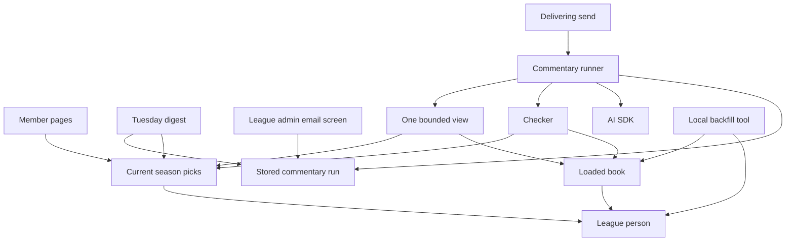
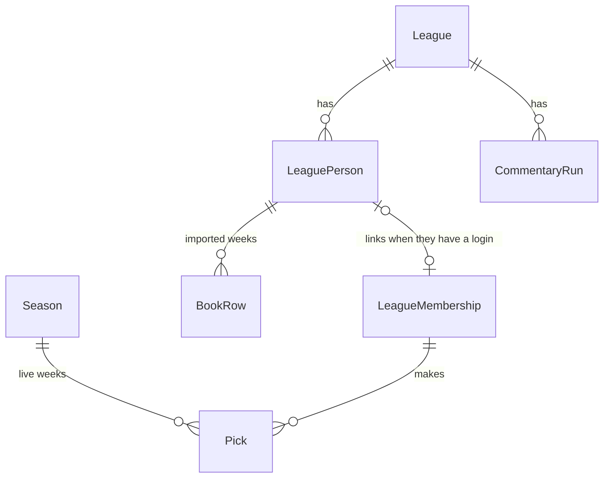

# Architecture Spine — AI weekly results commentary

## Design Paradigm

Checked lines. The model chooses the most impactful facts or broken records and writes up to three lines. A deterministic checker confirms the cited cells or drops the line. The model's sentence is stored unchanged when the cells match.

The host, database, Tuesday digest, and auth stay as the app already ships them. This spine adds the run, the book, and the checker.



## Invariants & Rules

### AD-1 — Checked claims [ADOPTED]

- **Binds:** CAP-2, the runner
- **Prevents:** a precomputed menu the model only ranks, a closed catalog of record types, prose with blanks the app fills, and the app rewriting a confirmed line
- **Rule:** The model reads the bounded view and proposes up to 3 lines, the ones it judges the most impactful facts or broken records. Each line is the sentence the model wrote plus the cells that sentence depends on. A cell is a league person, year, week, outcome, points, and the team when there is one. The app re-reads those cells from the database. A mismatch drops the line. The app stores the model's sentence unchanged when the cells match. The app does not decide which fact is most impactful and does not prove that a line is a record. The check does not spend. The run stops at 3 confirmed lines or the ceiling, whichever comes first. The ceiling may end the run before the best line is proposed. The quiet line stays the app's sentence and is stored only when the run finishes normally with zero confirmed lines.

### AD-2 — One loaded history [ADOPTED]

- **Binds:** CAP-2, CAP-4, the checker
- **Prevents:** writing the backfill as Pick rows, and a checker that reads only the backfill while a finished live season is a second history
- **Rule:** Imported years are book rows, not Pick rows. The checker reads one history joined on the league person. When the league has a live season for a year, the checker uses that season's picks and ignores book rows for that year. Other years come from book rows. A book row is unique on person, year, and week. No page renders past-season win/loss records or biggest-loser points as records. Member pages read only the current season. A later renew adds a completed live season to that history and does not move book-only people onto the roster. Renew is not built here.

### AD-3 — League person [ADOPTED]

- **Binds:** the checker, the backfill mapping, later invites
- **Prevents:** invented user accounts for screenshot-only people, joining history on a first-name string, and two persons for one member
- **Rule:** The app owns the league person. At most one person points at a membership. Before a run, the app links each current membership to its person, creating that person when the membership has none. The local tool uses that person for a mapped current member and creates a person only for a past member who still counts and has no membership. A book-only person has no user and no login. Invite lists use memberships.

### AD-4 — One stored run [ADOPTED]

- **Binds:** CAP-1, CAP-2, the cron send and the admin send
- **Prevents:** a preview, a manual send, a cron retry, and a crash retry each calling the model
- **Rule:** One record per league-week, for the week the digest is sending. When the feature is on and the send will deliver mail, the runner inserts that record before the model call and then updates it in place. A later attempt sees the record and does not call. An unfinished record is an abnormal stop under AD-5, not a second call. A suppressed test-league send does not insert a record and does not spend. Feature off means no record, no section, and no spend. No page calls the model.

### AD-5 — Scores send anyway [ADOPTED]

- **Binds:** the digest sender, the runner
- **Prevents:** holding the scores email, printing the quiet line for an error, and dropping proved items when a later call fails
- **Rule:** The scores email sends whether or not commentary succeeds. The record stores the stop reason and any proved lines. Proved items are kept. The quiet line is stored only when the run finishes normally with zero confirms. The digest and the admin screen render that same stored outcome. The digest includes the commentary section only when debug is off and the outcome is proved lines or the quiet line. Zero proved lines and an abnormal stop leave the section out. The week is not attempted again.

### AD-6 — App-built view [ADOPTED]

- **Binds:** the runner
- **Prevents:** a database login for the model, and a fetch per claim
- **Rule:** The app is the only querier. The view and the checker use one history query, keyed by league person. The view contains league person ids, outcomes, and points for this week and that history. It has no passwords, sessions, or credentials. The model proposes lines from that view. The app re-reads every cited cell against the database on the same person key.

### AD-7 — One client, priced config [ADOPTED]

- **Binds:** the runner, server config
- **Prevents:** a provider SDK hardcoded beside the AI SDK, and a price hardcoded for one model id
- **Rule:** The runner calls the Vercel AI SDK only and asks for a Zod list of lines. Each line is a sentence plus its cells. The runner does not trust a figure except by re-reading the cell. Server config holds the model id and the input and output price per million tokens. Spend is usage times that price, in decimal dollars, the same unit as the league ceiling. The runner does not start another call once the ceiling is reached. A missing price does not call, and that week follows AD-5.

### AD-8 — Who may write the switches [ADOPTED]

- **Binds:** CAP-1, CAP-3, CAP-5
- **Prevents:** an admin setting the ceiling or debug, and one ceiling shared by every league
- **Rule:** Each league has its own on/off flag, debug flag, and dollar ceiling. Both flags default off, including for leagues that already exist. The default ceiling is $1. A ceiling Kyle sets on that league replaces the default. The admin path writes only the on/off flag. Kyle's path writes the ceiling and the debug flag.

### AD-9 — Local backfill [ADOPTED]

- **Binds:** CAP-4
- **Prevents:** an importer inside the app, a private store the checker cannot read, and a CSV that drops cell fill
- **Rule:** The reader stays on Kyle's machine. It need not be committed or deployed, and it need not call the runner's client. Each file is one season of first names across weeks. The filename is the season year. A cell that names a team is that person's pick. The tool rejects a file whose year is the league's current season. It vision-reads the screenshot into a grid of first name, week, fill, and team, and prints that grid. It writes rows only after Kyle accepts, and only once every first name is mapped to a current member's league person or to a past member who still counts. Cell fill follows the historical legend: green is a win at 1, pale blue is a win against the jailed team at 2, red with a team is a loss at 0, empty red is a real loss with no team at 0 and counts for Biggest Loser in the same class as a submitted loss, yellow or orange is an invalid pick counted as a loss at 0. A plain CSV is rejected. A missing file omits that year and does not block the weekly feature. This spend is outside the weekly ceiling.

### AD-10 — Debug review [ADOPTED]

- **Binds:** CAP-5, the digest, the league admin email screen
- **Prevents:** a member page showing commentary, a second model call for review, and the admin screen repeating a week the digest already showed
- **Rule:** Debug is off until Kyle turns it on. While debug is on, the digest omits the commentary section and the league admin email screen shows the stored outcome from AD-5. A failure is not shown as the quiet line. While debug is off, that screen does not show the outcome, and the digest includes the section only as AD-5 allows. The screen does not call the model. Anyone who can open that league's admin screen can read a debug week.

### AD-11 — Named years [ADOPTED]

- **Binds:** the sentence writer
- **Prevents:** the words "league history" or "all-time" when a year was not in the history, and an app rewrite of the model's sentence to force that wording
- **Rule:** A printed comparison names the years it used. It does not say league history or all-time. Existence means the history the checker read. A sentence that says those words, or that compares years without naming them, is dropped. The app does not rewrite it.

## Consistency Conventions

| Concern | Convention |
| --- | --- |
| Naming | League person, book row, and commentary run. One commentary run per league, NFL season year, and week, the same key the Tuesday digest already uses. Columns stay snake_case. Primary keys stay cuid. |
| Data and formats | Ceiling and spend are decimal dollars in one unit. A stored commentary line is the model's sentence. The quiet line is exactly "Quiet week. Nothing new for the record book." A book row stores the person, year, week, outcome, points, and team when there is one. A cited cell uses that same shape. |
| State and cross-cutting | The run record is written once and then only read. Model id, token prices, and the model API key are server env. The on/off flag, debug flag, and ceiling are per-league columns. Admin writes the flag. Kyle writes debug and the ceiling. |

## Stack

| Name | Version |
| --- | --- |
| Next.js | 16.2.2 |
| React | 19.2.4 |
| Prisma | 7.8.0 |
| Zod | 4.3.6 |
| Vercel AI SDK (`ai`) | 7.0.165 |
| MUI | 7.3.11 |
| Prisma driver adapter (`@prisma/adapter-pg`) | 7.7.0 |
| Neon Postgres | existing project |
| Vercel | existing project |

## Structural Seed

The weekly path deploys with the existing Vercel app, in the production and preview environments that app already has. Cron and the admin send stay the triggers. Each environment holds its own server env for the model key, model id, and token prices. The local tool runs on Kyle's machine, sees the screenshots, and writes the app's tables. The vision call sees images only.

```text
src/lib/commentary/     # line schema, view, checker, runner
src/lib/email/          # digest reads the stored run and does not call the model
src/components/admin/   # debug week renders the stored outcome on the existing email screen
prisma/                 # league person, book row, commentary run, league switches
```



## Capability → Architecture Map

| Capability / Area | Lives in | Governed by |
| --- | --- | --- |
| CAP-1 On/off | League flag, written by the admin path | AD-4, AD-8 |
| CAP-2 Tuesday commentary | Runner, checker, stored run, digest | AD-1, AD-4, AD-5, AD-6, AD-7, AD-11 |
| CAP-3 Dollar ceiling | Per-league ceiling, Kyle's path, server prices | AD-7, AD-8 |
| CAP-4 Screenshot backfill | Local tool writes league person and book rows | AD-2, AD-3, AD-9 |
| CAP-5 Debug review | Debug flag, digest omit, admin email screen | AD-8, AD-10 |

## Deferred

- The renew flow. Completed live seasons already persist. Imported people stay off the invite list.
- The configured model id and its prices. The spine fixes where they live and that a missing price does not call. It does not pick the id.
- The vision model id on the local tool.
- Layout inside the existing admin email screen.
